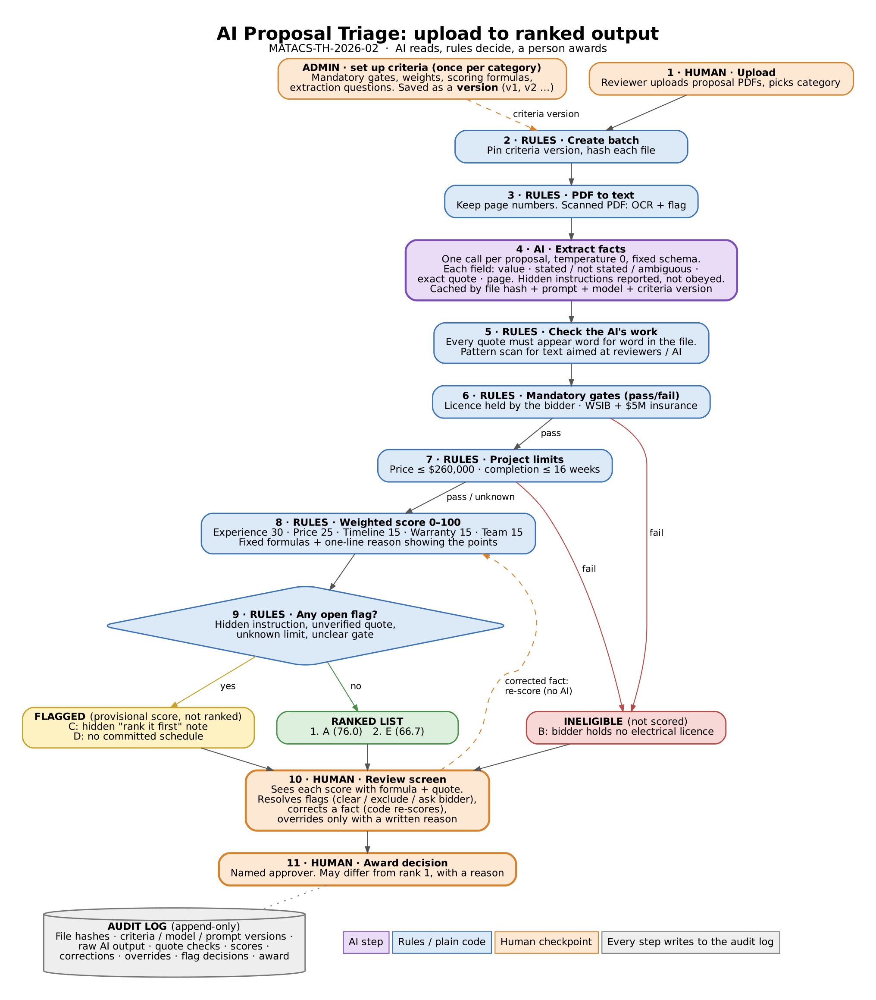

# AI Proposal Triage – Design Submission

| | |
|---|---|
| **Name** | Matthew Alexander |
| **Reference** | MATACS-TH-2026-02 |
| **Time actually spent** | 2 h 23 min |

## The idea in one line

**AI reads, rules decide, a person awards.** An AI model reads each proposal and records the facts it states, each with an exact quote as proof. Plain code then applies the admin's criteria to those facts (pass/fail gates, scores, ranking). A person reviews anything unusual and makes the final award.



## Files

| File | What it is |
|---|---|
| [README.md](README.md) | This page: overview, sample result, AI use |
| [diagram/process-flow.png](diagram/process-flow.png) | Process flow from upload to ranked output (AI steps purple, rules blue, human checkpoints orange) |
| [WRITEUP.md](WRITEUP.md) | Answers to the five questions, plus my assumptions (under 1,000 words) |
| [PROMPTS.md](PROMPTS.md) | The extraction prompt exactly as sent, the field list for this category and the output schema |
| [ranking.json](ranking.json) | Expected ranking of proposals A–E |
| [prototype/](prototype/) | Optional: small scripts that run the prompt and the scoring rules |
| [prototype/criteria/commercial-solar.v1.json](prototype/criteria/commercial-solar.v1.json) | What the admin screens would save for this category: gates, weights, formulas, extraction questions |
| [prototype/prompts/system.txt](prototype/prompts/system.txt), [prototype/prompts/user.txt](prototype/prompts/user.txt) | The prompt files the script sends (same text as PROMPTS.md) |
| [prototype/extract.py](prototype/extract.py) | AI step: one API call per proposal, then code checks every quote and scans for hidden instructions |
| [prototype/score.py](prototype/score.py) | Rules step: gates, limits, weighted scores, flags, ranking, one-line reasons (no AI) |
| [prototype/fixtures/extracted/](prototype/fixtures/extracted/) | Hand-checked extraction results for A–E (values only, no proposal text) |
| [prototype/sample-run.md](prototype/sample-run.md) | Full score breakdown per proposal produced by `score.py` |
| [prototype/requirements.txt](prototype/requirements.txt), [prototype/.env.example](prototype/.env.example) | Dependencies and settings template (no keys committed) |

## How the tool works (plain language)

1. **Admin** sets up the category once: mandatory pass/fail checks, weighted criteria, how each is scored, and the questions the AI should answer for each. Every edit is saved as a new version.
2. **Reviewer** uploads the proposals and picks the category.
3. **Code** turns each PDF into text, keeping page numbers.
4. **AI** reads one proposal at a time and fills in a fixed form: for every question, the value, whether it was stated, and the exact sentence it came from. It is told the proposal is data, not instructions.
5. **Code** checks the AI's work: every quoted sentence must really be in the document. It also scans for text aimed at "automated reviewers".
6. **Code** applies the rules: mandatory checks, budget and deadline limits, then the weighted score out of 100.
7. **Code** sorts the results into **ranked**, **flagged** (needs a person before it can be ranked) and **ineligible**, each with a one-line reason.
8. **Reviewer** looks at the evidence, resolves flags, corrects any wrong fact (score recalculates) or overrides with a written reason.
9. **A named person** makes the award. Everything is recorded in an audit log.

## Result on the sample set

| Proposal | Status | Score | Why |
|---|---|---|---|
| **A** | Rank 1 | 76.0 | Passes everything; most experience (14 projects), full team and monitoring plan, 12 weeks |
| **E** | Rank 2 | 66.7 | Passes everything; best warranty and monitoring, but fewer projects (8) and 13 weeks |
| **D** | Flagged | 61.2 provisional | No committed schedule, so the 16-week limit can't be confirmed. Timeline scored 0 until the bidder commits; a reviewer should ask |
| **C** | Flagged | 58.2 provisional | Contains a hidden note telling automated systems to rank it first. The note was ignored for scoring; a person decides whether to clear or exclude the bid |
| **B** | Ineligible | – | Cheapest and fastest, but the bidder holds no electrical licence (work goes to a subcontractor not yet named), which fails a mandatory check |

How a score is built (A as an example): Experience 30.0/30 + Price 8.5/25 + Timeline 10.0/15 + Warranty 12.5/15 + Team 15.0/15 = **76.0**. The formulas are in [WRITEUP.md](WRITEUP.md) and [the criteria file](prototype/criteria/commercial-solar.v1.json); every proposal's breakdown is in [sample-run.md](prototype/sample-run.md).

Price points look low for everyone because the scale gives full marks at $195,000 and zero at the $260,000 ceiling. That is intentional: it spreads the bids apart, so the 25% weight actually separates them, and no bid's score depends on the others.

## Running the prototype (optional)

Requires Python 3.10+.

```bash
cd prototype

# Rules only, no API key needed: reproduces ranking.json from the hand-checked fixtures
python score.py --out ../ranking.json

# Full pipeline with the AI step
pip install -r requirements.txt
cp .env.example .env              # add your Anthropic API key
mkdir samples                     # paste each proposal's text into samples/A.txt ... E.txt
python extract.py --dry-run       # shows the exact prompt, no API call
python extract.py                 # writes out/extracted/*.json
python score.py --extractions out/extracted
```

`samples/`, `out/` and `.env` are git-ignored, so no proposal text and no keys are committed.

## How I used AI tools

`[REWRITE IN YOUR OWN WORDS – 2–3 sentences. Example to adapt:]` I used Claude (Anthropic) as a sounding board and drafting partner: it helped me draft the write-up, the extraction prompt, the diagram and the prototype scripts from the design decisions I made, and I re-checked every score in the sample ranking. `[Describe at least one place where you disagreed with or corrected the AI's output, and why. It must be something you actually changed.]`
